# AGRONIX — Agricultural Governance & Agronomy Operating System

<div align="center">


[](LICENSE)
[](https://react.dev/)
[](https://www.typescriptlang.org/)
[](https://vitejs.dev/)
[](https://tailwindcss.com/)
[](https://supabase.com/)
[](https://developer.mozilla.org/en-US/docs/Web/Progressive_web_apps)
[](https://capacitorjs.com/)

**Official Field Operations, Statutory Enforcement & Agronomy Intelligence Platform**  
*Mandal Agricultural Office (MAO), Tiryani • Kumram Bheem Asifabad District • Department of Agriculture, Government of Telangana*

[Key Features](#key-features) • [System Architecture](#system-architecture) • [Module Directory](#module-directory) • [Statutory Enforcement](#statutory-enforcement--legal-compliance) • [AI & Knowledge Base](#ai--intelligence-pipeline) • [Setup & Deployment](#installation--deployment) • [Android Build](#android-apk-compilation)

</div>

---

## 🌾 About the Project

**AGRONIX** is an enterprise-grade, bilingual (**English & Telugu**), offline-first digital governance and agronomic management system engineered specifically for grassroots agricultural administration in the Government of Telangana.

Developed and maintained for the **Mandal Agricultural Office (MAO), Tiryani**—a predominantly tribal, remote agrarian jurisdiction in Kumram Bheem Asifabad District—AGRONIX bridges the critical divide between field inspection realities, statutory law enforcement, and real-time farmer advisory.

### The Operational Challenge
Agricultural extension officers (MAOs and AEOs) manage extensive regulatory, administrative, and agronomic responsibilities across vast rural areas with unreliable cellular connectivity:
* **Statutory Enforcement Burden:** Strict compliance with the *Essential Commodities Act, 1955*, *Fertiliser (Inorganic, Organic or Mixed) (Control) Order, 1985 (FCO)*, *Seeds Act, 1966*, and *Insecticides Act, 1968* requires accurate legal notices, sample drawal documents, and seizure memos. Drafting errors or missing mandatory clauses can void legal prosecutions in court.
* **Complex Multi-Copy Sampling:** Dual-coding and confidential sealing of laboratory test samples (Fertilizer Form J/K/L, Pesticide Form XX/XXI, Seed Form VIII) require tedious manual calculations, repetitive entries, and error-prone handwriting under harsh field conditions.
* **Fragmented Extension Data:** Farmer registries, input dealer stocks (Fertilizers, Seeds, Pesticides), subsidy schemes (NFSM, State Seed Cell), and crop disease outbreaks are traditionally managed on disconnected spreadsheets and paper registers.

### The AGRONIX Solution
AGRONIX transforms agricultural field operations into a streamlined, automated, and intelligent digital workbench:
1. **Automated Statutory Legal Engines:** Produces court-ready Show Cause Notices, Seizure Orders, Stop Sale Orders, and Revocations formatted to legal typography standards (1.15 line spacing, bilingual Telugu/English rendering, watermark protection, and strict clause citation).
2. **Confidential Sampling Hub:** Automates dual-coding sample registers, Form J/K/L and Form XX/XXI generation, covering letters with date lifecycle automation, and 65 CIBRC pesticide formulation type sanitizations.
3. **Hybrid AI Knowledge Base (RAG):** Full-text + vector hybrid search powered by `pgvector` and Ollama (`bge-m3` embeddings + `llama3.2`), allowing officers to ask natural-language questions and receive cited answers from official Acts, Rules, and Government Orders (GOs).
4. **On-Device Agronomic Intelligence:** TensorFlow.js disease detection, NPK fertilizer recommendation engines, knapsack tank-mix calculators, and land acreage converters that work completely offline in remote fields.
5. **Supply Chain & Subsidy Transparency:** Dealer stock reconciliation portals, IFMS validation, and beneficiary tracking for National Food Security Mission (NFSM) and state seed allocations.

---

## 🏛️ System Architecture

```mermaid
flowchart TD
    subgraph Users ["Field Users & Stakeholders"]
        MAO["Mandal Agricultural Officer (MAO)"]
        AEO["Agricultural Extension Officers (AEO)"]
        Dealers["Licensed Input Dealers (Fertilizer/Seed/Pesticide)"]
        Farmers["Farmers & Public Stakeholders"]
    end

    subgraph Presentation ["Presentation & Client Layer (Vite + React 18 SPA)"]
        PWA["Progressive Web App (Offline Service Worker)"]
        AndroidApp["Capacitor 8 Android Native Container"]
        I18n["Bilingual Engine (English / Telugu Unicode)"]
        PDFGen["Client-Side PDF/DOCX Engine (jsPDF + docx + harfbuzzjs)"]
        LocalTF["On-Device TensorFlow.js (Crop Disease Diagnosis)"]
    end

    subgraph ApplicationModules ["Core Feature Modules (project/src/features/)"]
        Toolkit["Officers' Toolkit & Legal Engine"]
        Sampling["Sampling Hub (Fertilizer / Pesticide / Seed)"]
        KB["Knowledge Base Assistant (RAG)"]
        Stock["Dealer Stock Portal & Analytics"]
        Calc["Agronomy & Soil Calculators"]
        Diary["Tour Diary & Inspection Logging"]
        FarmersDb["Farmer Database & Scheme Allotments"]
    end

    subgraph Backend ["Cloud Infrastructure & Backend (Supabase)"]
        Auth["Supabase Auth (Role-Based JWT)"]
        Postgres[("PostgreSQL 17 DB with RLS")]
        PgVector[("pgvector (1024-dim Embeddings)")]
        Storage["Supabase Private Storage (Signed URLs)"]
        EdgeFunc["Deno Edge Functions (knowledge-process, ask, search)"]
    end

    subgraph AIInfra ["Self-Hosted AI Infrastructure"]
        Ollama["Ollama Server (llama3.2 LLM)"]
        BGE["BGE-M3 Multilingual Embedding Model"]
    end

    MAO & AEO --> PWA & AndroidApp
    Dealers --> PWA
    Farmers --> PWA

    PWA & AndroidApp --> I18n & PDFGen & LocalTF
    PWA & AndroidApp --> ApplicationModules

    ApplicationModules --> Auth
    ApplicationModules --> Postgres
    ApplicationModules --> Storage
    KB --> EdgeFunc

    EdgeFunc --> PgVector
    EdgeFunc --> Ollama & BGE
```



---

## 📦 Module Directory

The application source code is strictly modularized under `project/src/features/`, following high-cohesion, low-coupling design principles:

| # | Feature Module | Directory | Core Capabilities | Primary Deliverables |
|---|---|---|---|---|
| 1 | **Officers' Toolkit** | `features/officers-toolkit/` | Show Cause Notices, Stop Sale Orders, Seizure Orders, Revocations, Dealer Inspections, FCO legal clauses explorer. | Court-ready statutory PDFs, violation charge sheets, inspection audits. |
| 2 | **Sampling Hub** | `features/sampling-hub/` | Statutory dual-coding sample registration, Fertilizer Forms J/K/L, Pesticide Forms XX/XXI, Seed Form VIII, Covering Letters. | Printable statutory forms, dual-code slips, laboratory dispatch letters (PDF/DOCX). |
| 3 | **Knowledge Base (RAG)** | `features/knowledge-base/` | Semantic chunking, pgvector similarity search, Deno edge pipeline, Ollama LLM Q&A, internal PDF viewer with page jumps. | Citation-backed legal advice, automated search across government circulars and GOs. |
| 4 | **Agronomic Calculators** | `features/calculators/` | Crop-specific NPK fertilizer dosage splits, land acreage converter, seed rates, plant population, pesticide tank-load doses. | Precision input plans, tank mix load schedules, regional unit conversions. |
| 5 | **Crop Doctor (AI)** | `features/crop-doctor/` | On-device camera/file pest & disease image classification via TensorFlow.js, agronomic disease encyclopedia, treatment recommendations. | Real-time disease diagnosis, cultural, biological, and chemical remediation plans. |
| 6 | **Field Diagnosis** | `features/field-diagnosis/` | Symptom-based field diagnostic wizard, natural language problem assessment, regional crop vulnerability matrix. | Actionable diagnostic summaries and advisory guidance for field extension. |
| 7 | **Dealer Stock Management** | `features/dealer-stock/` | Retail & wholesale dealer stock entry portal, opening balances, daily sales, invoice receipts, stock reconciliation. | Real-time buffer stock analytics, dealer compliance registers, Excel exports. |
| 8 | **Farmer Database** | `features/farmer-database/` | Village-wise farmer registry, land survey numbers, Aadhaar/bank linking, PM-KISAN, Rythu Bandhu tracking, Excel batch importer. | Clean farmer roster, landholding verification sheets, scheme eligibility logs. |
| 9 | **Tour Diary** | `features/tour-diary/` | Daily official tour logger, purpose tagging (inspections, training, crop assessment, grievance redressal), monthly reporting. | Formal monthly Tour Diary PDF formatted to Department of Agriculture norms. |
| 10 | **Crops Management** | `features/crop-management/` | Mandal crop planning, seasonal acreage tracking, variety master records, yield forecast logs. | Season-wise cropping pattern summaries and mandal yield records. |
| 11 | **Crop Protection** | `features/crop-doctor/` | Comprehensive pest, disease, weed, and nutrient deficiency encyclopedia for Telangana crops (Cotton, Redgram, Paddy, Chilli). | Standard Operating Procedures (SOPs) for Integrated Pest Management (IPM). |
| 12 | **Quality Control** | `features/quality-control/` | Mandal-level sample quota tracking, target vs. achievement analytics, testing lab status monitoring. | Monthly QC progress reports and statutory quota audit trails. |
| 13 | **Subsidy Cell & Schemes** | `features/schemes/` | National Food Security Mission (NFSM), State Seed Cell subsidy distribution, farm mechanization tools inventory. | Beneficiary allotment registers and subsidy audit ledgers. |
| 14 | **Document Directory** | `features/documents/` | Centralized repository for government orders (GOs), department circulars, memo archives with category tagging. | In-app document viewer, secure downloads, full-text search. |
| 15 | **Officer Directory** | `features/contacts/` | Directory of departmental officers across mandal, division, and district hierarchies with direct contact actions. | Hierarchical contact book with call/email integration. |
| 16 | **Dashboard & Analytics** | `features/dashboard/` | Executive KPI dashboard, 3D interactive satellite map of Tiryani Mandal, live weather telemetry (OpenWeather/Open-Meteo). | High-level situational awareness for mandal administrative leadership. |
| 17 | **Authentication & Roles** | `features/auth/` | Officer login, dealer authentication, role-based view enforcement, session inactivity guards. | Secure access control protecting confidential statutory records. |

---

## ⚖️ Statutory Enforcement & Legal Compliance

AGRONIX encodes Indian agricultural statutory law directly into software constraints, eliminating procedural irregularities during enforcement drives:

### 1. Fertiliser (Inorganic, Organic or Mixed) (Control) Order, 1985 (FCO)
* **Sampling Protocol:** Automated production of **Form J** (Notice to Dealer of intention to take sample), **Form K** (Memorandum to Fertilizer Testing Laboratory), and **Form L** (Confidential sample code slip).
* **Dual-Coding Safeguard:** Separates inspector identity and dealer details from the laboratory test packet to guarantee unbiased chemical analysis.
* **Stop Sale & Seizures:** Enforces **Clause 28** powers to issue Stop Sale Notices and Seizure Memos under strict contravention grounds.
* **Interactive Clause Explorer:** Instant lookup of all 39 FCO clauses, subclauses, penalties under Essential Commodities Act (ECA) 1955 Section 7(1)(a)(ii), and valid non-standard tolerance limits.

### 2. Seeds Act, 1966 & Seeds Rules, 1968
* **Sampling Protocol:** Automated generation of **Form VIII** (Inspection Notice), seed sample labels, and dispatch records.
* **Seizure & Revocation Orders:** Generates **Form III** seizure orders and revocation memos specifying lot numbers, variety, germinability standards, and validity tags.
* **Dealer Inspection Audits:** Structured checklist assessing stock display boards, price lists, cash memos, and seed lot storage standards under Seed (Control) Order 1983.

### 3. Insecticides Act, 1968 & Insecticides Rules, 1971
* **Sampling Protocol:** Produces **Form XX** (Notice of sampling to dealer) and **Form XXI** (Memorandum to Government Insecticide Analyst).
* **Formulation Standardization:** Features a built-in sanitization engine recognizing **65 CIBRC approved formulation types** (`EC`, `SC`, `WDG`, `AI`, `ZC`, `RTU`, `SL`, `WP`, `FS`, `GR`, etc.), automatically parsing active ingredient percentages and preventing duplicate suffix formatting.
* **Stop Sale & Seizure Orders:** Formats formal seizure and stop-sale orders citing **Section 21(1)** powers with statutory return schedules.

### 4. Legal Typography & Document Layout Standards
* **1.15 Legal Line Spacing:** Strictly conforms to official legal document layout requirements, avoiding crowded text and maintaining professional administrative aesthetics.
* **Bilingual Unicode Support:** Integrates `harfbuzzjs` and `fontkit` with `NotoSansTelugu` font loading to ensure accurate glyph shaping for complex Telugu conjuncts in exported PDF documents.
* **Tamper-Evident Watermarking:** Automatically adds administrative watermarks, verification hashes, and officer signature blocks.

---

## 🧠 AI & Intelligence Pipeline

AGRONIX incorporates a multi-tiered AI architecture operating both on-device (offline) and in the cloud:

### 1. On-Device Edge Computer Vision (TensorFlow.js)
* **Model:** Deep Convolutional Neural Network (MobileNet-based) optimized for browser execution via WebGL/WASM backends.
* **Functionality:** Real-time leaf disease diagnosis from camera feeds or uploaded images.
* **Privacy & Resilience:** Operates without transmitting images across the network, enabling instant diagnostics in zero-connectivity fields.
* **Heuristic Diagnostic Engine:** Fallback rule-based system correlating observed symptoms (leaf discoloration, stem lesions, wilting, pest damage) with regional seasonal patterns.

### 2. Retrieval-Augmented Generation (RAG) Knowledge Assistant
```
Official Acts & Circulars (PDF/DOCX)
  ├── 1. Chunking & Extraction (Supabase Edge Function: knowledge-process)
  ├── 2. Multilingual Dense Embeddings (Ollama bge-m3, 1024-dim vectors)
  └── 3. Storage in Postgres 17 (pgvector + tsvector Full-Text Search)

User Query (Natural Language)
  ├── 1. Query Embedding (bge-m3)
  ├── 2. Hybrid Search RPC (Cosine Distance + Keyword BM25 Ranking)
  ├── 3. Context Injection with [SOURCE_N] Tags
  └── 4. LLM Synthesis (Ollama llama3.2) ──> Streamed Answer + Direct Page Citations
```
* **No AI Vendor Lock-in:** Completely self-hosted via Ollama. No proprietary third-party API dependencies or data leakage.
* **Graceful Degradation:** If the Ollama server is unreachable, the system automatically falls back to full-text search and delivers exact matched document chunks without breaking the user experience.

---

## 🛠️ Technology Stack

```
Frontend:
  ├── Core Framework: React 18.3.1 (Vite 5.4 SPA)
  ├── Language: TypeScript 5.5 (Strict typing enabled)
  ├── Styling: Tailwind CSS 3.4 + Custom Government Color Palette
  ├── Icons: Lucide React
  ├── Data Visualization: Recharts 3.8.1
  └── Router: React Router DOM 6.30 (Code-split lazy loaded routes)

Document & PDF Engineering:
  ├── PDF Generation: jsPDF 4.2 + jsPDF-AutoTable 5.0 + pdf-lib 1.17
  ├── PDF Viewing & Rendering: pdfjs-dist 6.0
  ├── Word Processing: docx 9.7 + mammoth 1.12
  ├── Spreadsheet Processing: xlsx (SheetJS) 0.18 + exceljs 4.4
  └── Typography & Shaping: fontkit 2.0 + harfbuzzjs 1.6 (Telugu script engine)

Artificial Intelligence & Data:
  ├── Vision AI: TensorFlow.js 4.22 (WebGL accelerated)
  ├── LLM & RAG: Ollama (llama3.2 + bge-m3 1024-dim embeddings)
  └── Database Vector Store: PostgreSQL 17 + pgvector extension

Backend & Cloud (Supabase):
  ├── Database: PostgreSQL 17 with strict Row-Level Security (RLS)
  ├── Authentication: Supabase Auth (JWT with custom claims)
  ├── Storage: Supabase Storage (Private buckets with signed URL access)
  └── Serverless Compute: Deno Edge Functions

Mobile & PWA Container:
  ├── Offline Engine: Service Worker + IndexedDB + LocalStorage fallback
  └── Native Mobile: Capacitor 8.4 (Android native wrapper)
```

---

## 💻 Installation & Deployment

### Prerequisites
* **Node.js:** v18.18.0 or higher (v20+ recommended)
* **npm:** v10.0.0 or higher
* **Supabase Project:** Supabase instance (cloud or self-hosted) with Postgres 17.
* **Ollama (Optional, for Knowledge Base RAG):** Running instance with `bge-m3` and `llama3.2` models.

### Step 1: Clone the Repository
```bash
git clone https://github.com/vinayreddy166/agri-portal-tiryani.git
cd agri-portal-tiryani
```

### Step 2: Configure Environment Variables
Create a `.env` file inside the `project/` directory:
```bash
cd project
cp .env.example .env
```
Populate the required environment variables:
```ini
# Supabase Configuration
VITE_SUPABASE_URL=https://your-supabase-id.supabase.co
VITE_SUPABASE_ANON_KEY=your-supabase-anon-key

# Mapping & Telemetry (Optional)
VITE_GOOGLE_MAPS_API_KEY=your-google-maps-key # Falls back to iframe map if omitted
VITE_OPENWEATHER_API_KEY=your-openweather-key # Falls back to Open-Meteo if omitted

# AI & Crop Models (Optional)
VITE_CROP_MODEL_URL=/models/crop-disease/model.json
```

### Step 3: Install Dependencies
```bash
npm install
```

### Step 4: Run Development Server
```bash
npm run dev
```
The application will launch at `http://localhost:5173/`.

---

## 🧪 Development, Testing & Verification Commands

All development tasks should be run from within the `project/` directory:

```bash
# Start Vite development server
npm run dev

# Run strict TypeScript typecheck (verifies all interfaces and strict flags)
npm run typecheck

# Run unit and integration tests (Vitest)
npm test

# Run specific agronomy calculation engine verification
npm run test:fertilizer

# Run ESLint validation
npm run lint

# Compile production bundle
npm run build

# Preview production build locally
npm run preview
```

> [!TIP]
> If `typecheck` or `build` exhausts Node memory on resource-constrained machines, allocate additional heap:
> ```powershell
> # Windows PowerShell
> $env:NODE_OPTIONS="--max-old-space-size=6144"; npm run typecheck
> ```
> ```bash
> # Linux / macOS Bash
> NODE_OPTIONS="--max-old-space-size=6144" npm run typecheck
> ```

---

## 📱 Android APK Compilation

AGRONIX is fully configured with **Capacitor 8** for deployment as a native Android application:

```bash
cd project

# 1. Compile the web bundle
npm run build

# 2. Sync web assets into Android project
npm run android:sync

# 3. Open in Android Studio (to sign/debug)
npx cap open android

# Or build debug APK directly via command line
npm run android:apk
```
The compiled APK will be generated at:
`project/android/app/build/outputs/apk/debug/app-debug.apk`

---

## 🗄️ Database & Migration Setup

Database migrations reside in `supabase/migrations/`:
1. `20260913120000_create_knowledge_base.sql`: Vector extensions, document chunks, processing jobs, RLS rules.
2. `20260913120100_knowledge_rpc.sql`: `knowledge_vector_search` and `knowledge_keyword_search` stored procedures.

Deploy migrations to your remote Supabase instance:
```bash
supabase db push
# Or apply SQL migrations directly in the Supabase SQL Editor
```

Deploy the Deno Edge Functions:
```bash
supabase functions deploy knowledge-process
supabase functions deploy knowledge-search
supabase functions deploy knowledge-ask
```

Set server-side Ollama secrets for Edge Functions:
```bash
supabase secrets set OLLAMA_BASE_URL=http://your-ollama-host:11434
supabase secrets set OLLAMA_CHAT_MODEL=llama3.2
supabase secrets set OLLAMA_EMBEDDING_MODEL=bge-m3
supabase secrets set RAG_EMBEDDING_DIM=1024
supabase secrets set RAG_ENABLED=true
```

---

## 🔒 Security & Privacy Posture

* **Row Level Security (RLS):** Enabled across all database tables. Officers authenticate via Supabase Auth; admin privileges are locked to designated official email IDs (`k.vinayreddy166@gmail.com`).
* **Zero Browser AI Leakage:** No server tokens or LLM credentials reach the browser; vector search and AI synthesis execute exclusively inside isolated Deno Edge Functions and self-hosted Ollama containers.
* **Storage Isolation:** Statutory notices, inspection logs, and sampling letters are stored in private storage buckets accessible only via time-bounded signed URLs.
* **Data Sovereignty:** Farmer land records, Aadhaar references, and dealer financial details stay within the departmental database ecosystem.

---

## 👤 Author & Administrative Contact

**K. Vinay Reddy**  
*Mandal Agricultural Officer (MAO)*  
Mandal Agricultural Office, Tiryani  
Kumram Bheem Asifabad District, Telangana  
📧 Email: `k.vinayreddy166@gmail.com`  

---

<div align="center">
  <sub>Built with dedication for the farming community and agricultural officers of Tiryani Mandal, Telangana.</sub>
</div>
